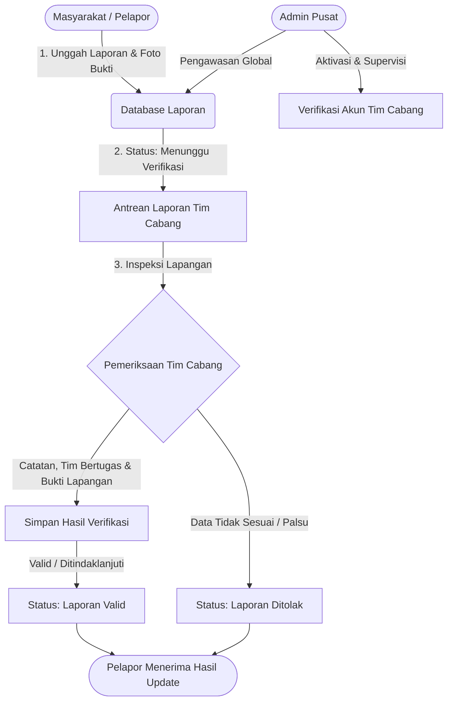

# 📢 Laporin Yuk!
> **Platform Pengaduan dan Aspirasi Publik Cepat, Transparan, dan Terverifikasi Lapangan**

[](https://react.dev/)
[](https://vitejs.dev/)
[](https://tailwindcss.com/)
[](https://nodejs.org/)
[](https://supabase.com/)
[](https://vercel.com/)

---

## 📌 Tentang Proyek

**Laporin Yuk!** adalah sistem pelaporan pengaduan masyarakat modern yang menghubungkan warga secara langsung dengan unit kerja penanganan di tingkat kecamatan/cabang dan tim pengawas pusat. 

Sering kali aduan publik mengenai fasilitas umum yang rusak, isu lingkungan hidup, atau keluhan fasilitas terlambat ditindaklanjuti karena birokrasi yang berbelit dan ketiadaan sistem verifikasi lapangan yang transparan. **Laporin Yuk!** menjawab tantangan ini dengan menyediakan:
- Pelaporan publik yang mudah, cepat, dan berbasis bukti dokumentasi.
- Alur verifikasi berjenjang oleh **Tim Cabang Lapangan** lengkap dengan catatan penanganan dan foto bukti hasil tindak lanjut.
- Pengawasan terpusat oleh **Admin Pusat** untuk validasi tim kerja dan rekapitulasi data wilayah.

---

## ✨ Fitur Utama Berdasarkan Peran

### 1. 👥 Pelapor (Masyarakat)
- **Registrasi & Otentikasi Mudah**: Akun personal yang aman untuk memantau seluruh riwayat pengaduan.
- **Buat Laporan Interaktif**:
  - Input judul, deskripsi rinci, dan pemilihan lokasi berdasarkan kecamatan.
  - Klasifikasi kategori laporan (*Kerusakan Fasilitas Umum*, *Penyimpangan Dana*, *Isu Lingkungan*).
  - Unggah foto bukti laporan langsung ke cloud storage.
- **Pelacakan Status Real-Time**: Status laporan yang transparan (*Menunggu Verifikasi*, *Laporan Valid*, *Laporan Ditolak*).

### 2. 👷 Tim Cabang (Verifikator Lapangan)
- **Registrasi Akun Tim Khusus**: Formulir pendaftaran tim cabang 2 tahap (akun & detail wilayah) yang diverifikasi terlebih dahulu oleh Admin Pusat.
- **Manajemen Antrean Aduan Wilayah**: Filter pengaduan berdasarkan status verifikasi dan kategori aduan.
- **Formulir Verifikasi Lapangan**:
  - Pencatatan tanggal inspeksi/pemeriksaan fisik di lapangan.
  - Pemilihan anggota tim yang bertugas (checklist penugasan).
  - Catatan detail tindak lanjut atau kondisi riil di lapangan.
  - Unggah foto bukti hasil penanganan/inspeksi lapangan.
  - Penetapan status akhir laporan (*Terima Laporan* / *Tolak Laporan*).

### 3. 🛡️ Admin Pusat (Supervisi & Tata Kelola)
- **Manajemen Akun Tim Cabang**: Verifikasi kelayakan dan aktivasi akun tim cabang baru.
- **Monitoring Laporan Komprehensif**: Pemantauan aduan di seluruh kecamatan dan status penanganannya.
- **Manajemen Wilayah**: Pengelolaan data master kecamatan.

---

## 🔄 Alur Kerja Sistem (System Workflow)



---

## 💻 Tech Stack

| Lapisan | Teknologi | Deskripsi |
| :--- | :--- | :--- |
| **Frontend Framework** | **React 19** | Library UI modern dengan performa tinggi & compiler teroptimasi |
| **Build Tool** | **Vite 8.3** | Bundler kilat untuk efisiensi pengembangan dan build aset produksi |
| **Styling** | **Tailwind CSS v4** | Framework utilitas CSS terintegrasi untuk tampilan responsif |
| **State Management** | **Zustand** | Manajemen state aplikasi yang ringan, bersih, dan modular |
| **Routing** | **React Router v7** | Routing client-side terstruktur untuk navigasi antar halaman |
| **Icons** | **Lucide React & React Icons** | Koleksi ikon vektor yang konsisten dan modern |
| **HTTP Client** | **Axios** | Komunikasi data asinkronus ke REST API dengan interceptor |
| **Backend Framework** | **Node.js & Express 5** | RESTful API backend dengan routing modular & middleware CORS |
| **Database & Auth** | **Supabase (PostgreSQL)** | Penyimpanan data relasional aman dan terstruktur |
| **Cloud Storage** | **Supabase Storage** | Bucket penyimpanan gambar & dokumen bukti pengaduan |
| **Hosting & Deploy** | **Vercel** | Deployment serverless backend dan edge network delivery |

---

## 📁 Struktur Direktori

```text
laporin-yuk/
├── backend/
│   ├── config/              # Konfigurasi Supabase & environment
│   ├── controllers/         # Logika bisnis API (auth, laporan, tim branch, dll)
│   ├── middlewares/         # Middleware autentikasi JWT & validasi
│   ├── routes/              # Routing endpoint REST API Express
│   ├── app.js               # Entry point Express backend & middleware CORS
│   ├── package.json         # Dependensi backend
│   ├── vercel.json          # Konfigurasi edge CORS & deployment Vercel
│   └── env.example          # Template konfigurasi environment backend
│
├── frontend/
│   ├── public/              # Aset publik statis
│   ├── src/
│   │   ├── components/      # Komponen UI modular (Navbar, AlertModal, Form, dll)
│   │   ├── pages/           # Halaman view (Beranda, Auth, Tim Cabang, Admin)
│   │   ├── services/        # Service layer integrasi API Axios
│   │   ├── stores/          # Zustand store (useAuthStore, useAlertStore, dll)
│   │   ├── App.jsx          # Root component & konfigurasi routing
│   │   └── main.jsx         # Titik awal mount aplikasi React
│   ├── package.json         # Dependensi frontend
│   ├── vite.config.js       # Konfigurasi Vite & Tailwind plugin
│   └── .env.example         # Template konfigurasi environment frontend
│
└── README.md                # Dokumentasi utama proyek
```

---

## 🚀 Panduan Instalasi & Menjalankan Proyek

### 📋 Prasyarat Sistem
- **Node.js**: Versi `18.x` atau yang lebih baru (disarankan Node.js `20+` LTS).
- **npm** atau **pnpm** terpasang pada komputer Anda.
- **Git** untuk kloning repository.

---

### Langkah 1: Kloning Repository
```bash
git clone https://github.com/username-anda/laporin-yuk.git
cd laporin-yuk
```

---

### Langkah 2: Setup & Jalankan Backend

1. Masuk ke direktori `backend`:
   ```bash
   cd backend
   ```
2. Instal semua dependensi:
   ```bash
   npm install
   ```
3. Konfigurasikan Environment Variables:
   - Salin file `env.example` menjadi `.env`:
     ```bash
     cp env.example .env
     ```
   - Isi konfigurasi kredensial Supabase Anda di dalam `.env`:
     ```env
     PORT=3000
     SUPABASE_URL=https://proyek-anda.supabase.co
     SUPABASE_ANON_KEY=your_supabase_anon_key
     SUPABASE_SERVICE_ROLE_KEY=your_supabase_service_role_key
     ```
4. Jalankan backend server:
   - Mode Pengembangan (*Development dengan nodemon*):
     ```bash
     npm run dev
     ```
   - Mode Produksi (*Production*):
     ```bash
     npm start
     ```
   > Backend akan aktif di: `http://localhost:3000`

---

### Langkah 3: Setup & Jalankan Frontend

1. Buka terminal baru dan masuk ke direktori `frontend`:
   ```bash
   cd frontend
   ```
2. Instal seluruh dependensi frontend:
   ```bash
   npm install
   ```
3. Konfigurasikan Environment Variables:
   - Salin file `.env.example` menjadi `.env`:
     ```bash
     cp .env.example .env
     ```
   - Sesuaikan alamat API backend:
     ```env
     VITE_API_URL=http://localhost:3000/api
     ```
     *(Atau gunakan URL deployment backend jika ingin menguji langsung ke server online).*
4. Jalankan frontend development server:
   ```bash
   npm run dev
   ```
5. Buka browser dan kunjungi:
   ```text
   http://localhost:5173
   ```

---

## ⚙️ Ringkasan Variabel Lingkungan (`.env`)

### Backend (`backend/.env`)
| Variabel | Penjelasan | Contoh |
| :--- | :--- | :--- |
| `PORT` | Port lokal server Express | `3000` |
| `SUPABASE_URL` | URL endpoint instans Supabase Anda | `https://xyzcompany.supabase.co` |
| `SUPABASE_ANON_KEY` | Public client API key Supabase | `eyJhbGciOi...` |
| `SUPABASE_SERVICE_ROLE_KEY` | Service role key Supabase (akses server aman) | `eyJhbGciOi...` |

### Frontend (`frontend/.env`)
| Variabel | Penjelasan | Contoh |
| :--- | :--- | :--- |
| `VITE_API_URL` | Base URL endpoint API backend Express | `http://localhost:3000/api` |

---

## 🎯 Nilai Tambah untuk Penilaian Mentor / Juri

1. **Struktur Kode Bersih (*Clean Code & Modular Architecture*)**:
   - Pemisahan tanggung jawab yang jelas antara Service Layer (komunikasi data), Store Layer (state management dengan Zustand), dan Presentation Layer (komponen React).
   - Penanganan error terpusat melalui komponen [AlertModal](file:///d:/Materi%20Pembelajaran/project/laporin-yuk/frontend/src/components/AlertModal.jsx) yang konsisten.
2. **Kesesuaian Desain & Pengalaman Pengguna (UI/UX)**:
   - Tampilan bersih (*sleek & responsive*) dengan palet warna navy profesional.
   - Feedback interaktif langsung saat aksi verifikasi, tolak laporan, atau pendaftaran akun.
3. **Penyelesaian Masalah Nyata (*Real-World Impact*)**:
   - Menghilangkan friksi aduan palsu dengan validasi lapangan berfoto dan penugasan tim resmi.
   - Memastikan transparansi proses dari awal aduan masuk hingga verifikasi selesai.

---

## 📄 Lisensi & Kontributor

Dikembangkan dengan dedikasi untuk kompetisi inovasi teknologi pelayanan publik oleh tim **Laporin Yuk!**.
Semua hak cipta dilindungi undang-undang © 2026.

